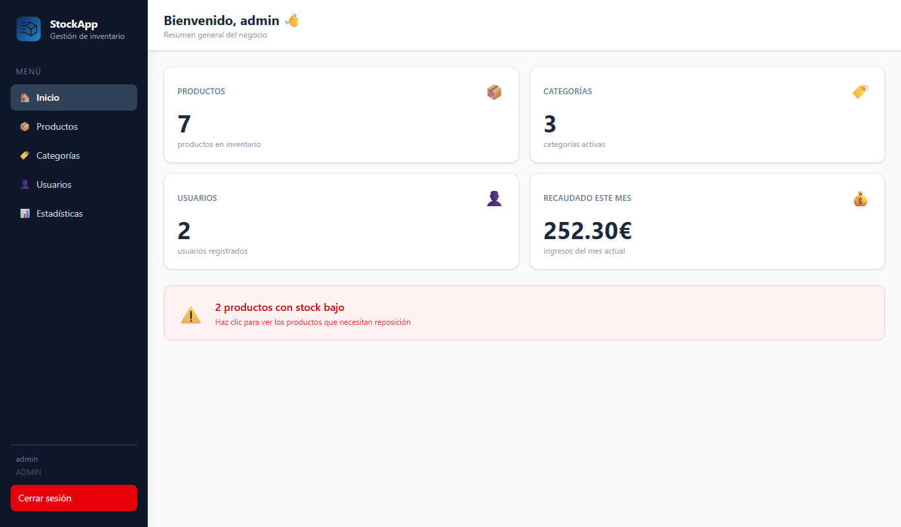
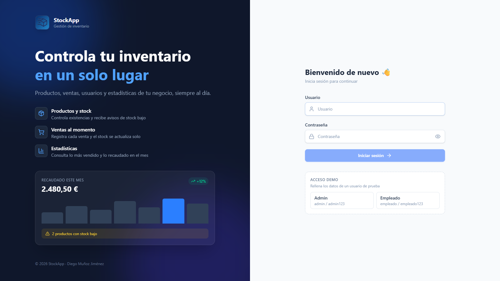
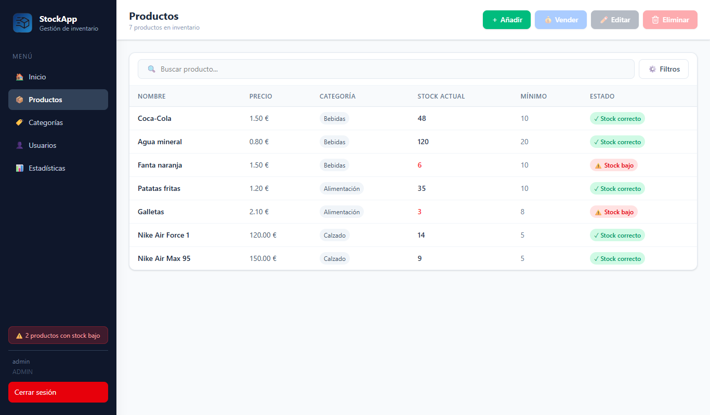
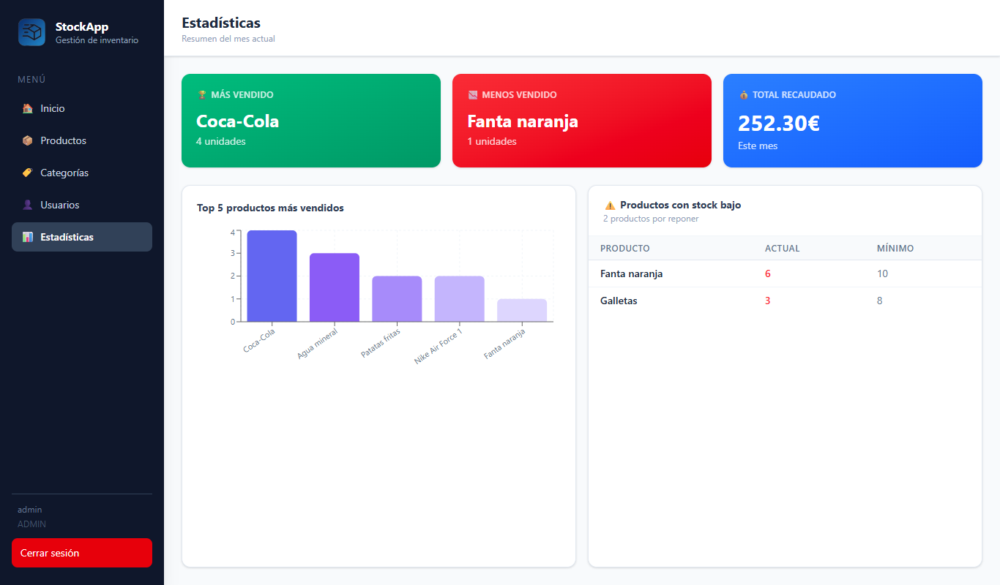
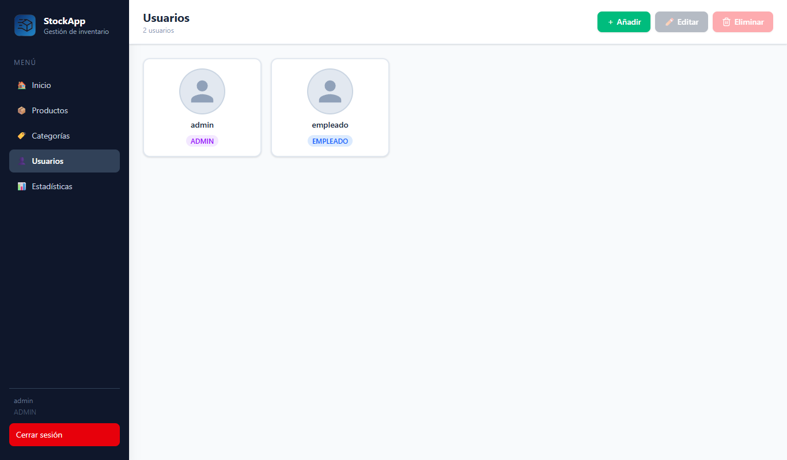
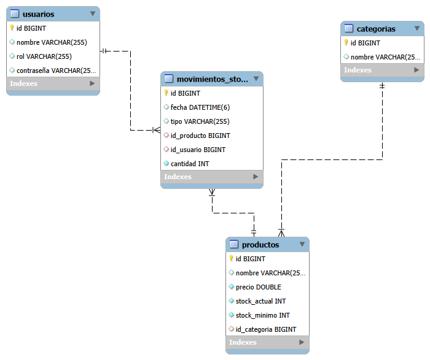

<div align="center">


# StockApp

**Gestor de inventario full-stack para pequeños comercios**

Controla productos, categorías, ventas, usuarios y estadísticas desde una aplicación web.


</div>

---

Proyecto de fin de grado (TFG) del ciclo de **Desarrollo de Aplicaciones Multiplataforma (DAM)**.
Empezó como una aplicación de escritorio en JavaFX y la he migrado a una **arquitectura cliente-servidor**: un backend con API REST en Spring Boot y un frontend web en React. También incluye una app Android que usa la misma API pensada para empleados.



## Índice

- [Funcionalidades](#funcionalidades)
- [Capturas](#capturas)
- [Tecnologías](#tecnologías)
- [Arquitectura](#arquitectura)
- [Cómo ejecutarlo](#cómo-ejecutarlo)
- [Usuarios de prueba](#usuarios-de-prueba)
- [API REST](#api-rest)
- [Estructura del proyecto](#estructura-del-proyecto)
- [Próximos pasos](#próximos-pasos)

## Funcionalidades

| Módulo | Qué permite hacer | Rol |
|---|---|---|
| **Login** | Inicio de sesión con contraseñas cifradas con BCrypt y acceso demo con un clic | Todos |
| **Dashboard** | Resumen del negocio: productos, categorías, usuarios, ingresos del mes y avisos de stock bajo | Todos |
| **Productos** | Listado con búsqueda y filtros, alta, edición y baja, registro de ventas (descuenta stock) y aviso de stock bajo | Todos |
| **Categorías** | Alta, edición y baja de categorías (al borrar una se eliminan sus productos y movimientos) | Todos |
| **Usuarios** | Alta, edición y baja de usuarios con rol y foto de perfil | Admin |
| **Estadísticas** | Producto más y menos vendido, total recaudado y gráfico del top 5 del mes | Admin |

## Capturas

| Login | Productos |
|---|---|
|  |  |
| **Estadísticas** | **Usuarios** |
|  |  |

## Tecnologías

**Backend** (`backend_Java/`)
- Java 21 y Spring Boot 4 (Spring Web MVC, Spring Data JPA, Hibernate)
- MySQL 8
- BCrypt para cifrar las contraseñas
- Maven (incluye wrapper `mvnw`, no hace falta instalarlo)

**Frontend** (`frontend/`)
- React 19 con TypeScript y Vite
- Tailwind CSS 4
- React Router (rutas protegidas por rol)
- Zustand (estado de la sesión)
- Axios (llamadas a la API)
- Recharts (gráficos)

**Móvil** (`android/`)
- Kotlin, Jetpack Compose y Retrofit

## Arquitectura

```
┌────────────────────────┐        ┌────────────────────────────────┐        ┌──────────────┐
│  Frontend React (web)  │  HTTP  │  Backend Spring Boot           │  JPA   │    MySQL     │
│  http://localhost:8080 │ ─────► │  API REST /api                 │ ─────► │   stock_db   │
└────────────────────────┘  JSON  │  Controller → Service → Repo   │        └──────────────┘
┌────────────────────────┐        │                                │
│  App Android (Kotlin)  │ ─────► │  También sirve la web de React │
└────────────────────────┘        └────────────────────────────────┘
```

- El backend sigue una arquitectura por capas: `api` (controlador REST) → `service` (lógica de negocio) → `repository` (Spring Data JPA) → `model` (entidades).
- Al compilar, Maven construye el frontend de React y lo empaqueta dentro del backend. Así, **toda la aplicación se arranca con un solo comando** y se sirve desde `http://localhost:8080`.
- Al arrancar, la base de datos y las tablas se crean solas. Si está vacía, se cargan datos de ejemplo.

Modelo de datos:



## Cómo ejecutarlo

### Requisitos

- **Java 21** (por ejemplo [Eclipse Temurin](https://adoptium.net/))
- **MySQL 8** arrancado en `localhost:3306`

No hace falta instalar Maven ni Node.js: el wrapper de Maven descarga lo necesario la primera vez.

### 1. Clonar el repositorio

```bash
git clone https://github.com/Diego6229/StockApp.git
cd StockApp/backend_Java
```

### 2. Configurar MySQL (si tu contraseña no es la de por defecto)

Por defecto se conecta con el usuario `root` y la contraseña `1234`. Si los tuyos son otros, defínelos antes de arrancar:

```bash
# Windows (PowerShell)
$env:DB_USER="root"; $env:DB_PASSWORD="tu_contraseña"

# Linux / macOS
export DB_USER=root DB_PASSWORD=tu_contraseña
```

### 3. Arrancar

```bash
# Windows
.\mvnw.cmd spring-boot:run

# Linux / macOS
./mvnw spring-boot:run
```

Se abrirá el navegador en **http://localhost:8080**. La primera vez tarda un poco más, porque descarga las dependencias y compila el frontend.

> **Desde VS Code:** abre la carpeta del proyecto y ejecuta la tarea **Iniciar StockApp** (`Ctrl+Shift+P` → *Tasks: Run Task*). También puedes ejecutar `MainApp` con **F5**, después de compilar el frontend una vez con la tarea **Compilar frontend**.

### Desarrollo del frontend con recarga en caliente

Con el backend arrancado:

```bash
cd frontend
npm install
npm run dev
```

Abre http://localhost:1420. Las llamadas a `/api` se redirigen al backend.

## Usuarios de prueba

Se crean automáticamente la primera vez que arranca la aplicación con la base de datos vacía. También puedes usar los botones de **Acceso demo** de la pantalla de login, que rellenan los datos por ti:

| Usuario | Contraseña | Rol |
|---|---|---|
| `admin` | `admin123` | ADMIN (acceso completo) |
| `empleado` | `empleado123` | EMPLEADO (productos, categorías y ventas; sin acceso a usuarios ni estadísticas) |
> Si no funciona, probar --> usuario: Prueba | Contraseña: 1234.


## API REST

URL base: `http://localhost:8080/api`

| Método | Endpoint | Descripción |
|---|---|---|
| `POST` | `/login?nombre=&password=` | Iniciar sesión |
| `GET` | `/dashboard` | Datos resumen del dashboard |
| `GET` · `POST` | `/productos` | Listar · crear productos |
| `PUT` · `DELETE` | `/productos/{id}` | Editar · eliminar un producto |
| `POST` | `/venta/{idProducto}?idUsuario=` | Registrar una venta (descuenta 1 unidad de stock) |
| `GET` · `POST` | `/categorias` | Listar · crear categorías |
| `PUT` · `DELETE` | `/categorias/{id}` | Editar · eliminar una categoría |
| `GET` · `POST` | `/usuarios` | Listar · crear usuarios |
| `PUT` · `DELETE` | `/usuarios/{id}` | Editar · eliminar un usuario |
| `GET` | `/estadisticas/mas-vendidos` | Ranking de ventas del mes |
| `GET` | `/estadisticas/total-recaudado` | Ingresos del mes |
| `GET` | `/estadisticas/stock-bajo` | Productos por debajo del stock mínimo |

## Estructura del proyecto

```
StockApp/
├── backend_Java/                 Backend Spring Boot
│   ├── pom.xml                   Dependencias y build (incluye la compilación del frontend)
│   └── src/main/
│       ├── java/stock/
│       │   ├── MainApp.java      Punto de entrada: arranca el servidor y abre el navegador
│       │   ├── api/              Controlador REST (/api)
│       │   ├── service/          Lógica de negocio
│       │   ├── repository/       Acceso a datos (Spring Data JPA)
│       │   ├── model/            Entidades: Usuario, Producto, Categoria, MovimientoStock
│       │   ├── config/           Datos de ejemplo
│       │   └── web/              Sirve la aplicación React
│       └── resources/application.properties
├── frontend/                     Frontend React + TypeScript
│   └── src/
│       ├── pages/                Login, Dashboard, Productos, Categorías, Usuarios, Estadísticas
│       ├── services/             Llamadas a la API (Axios)
│       ├── store/                Sesión del usuario (Zustand)
│       └── components/           Rutas protegidas por rol
├── android/                      App móvil Android (Kotlin + Compose)
├── base-datos/schema.sql         Esquema de la base de datos (referencia)
└── docs/                         Capturas y diagrama entidad-relación
```

### App Android

La carpeta `android/` contiene una app móvil (Kotlin + Jetpack Compose + Retrofit) para iniciar sesión, consultar productos y registrar ventas. Usa la misma API. Para probarla, ábrela con Android Studio y ejecútala en un emulador con el backend arrancado. El emulador accede al ordenador a través de `10.0.2.2:8080`.

## Próximos pasos

- [ ] Migrar la base de datos a la nube (por ejemplo Supabase o PlanetScale) y desplegar una demo pública.
- [ ] Autenticación con tokens JWT y validación de roles también en el backend (ahora se controla en el frontend).
- [ ] Registrar entradas de stock (reposición) desde la interfaz.
- [ ] Tests de la API y del frontend.

## Autor

**Diego Muñoz Jiménez**: [GitHub](https://github.com/Diego6229)

Licencia [MIT](LICENSE).
